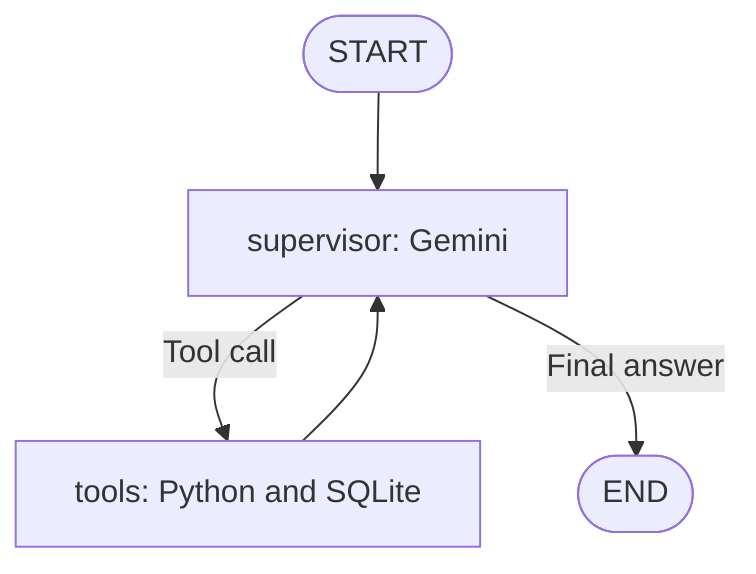

# UZEX Trading Agent

A Telegram data-analysis agent built with **LangGraph, Google Gemini, aiogram, and SQLite**. Ask natural-language questions about a fictional UZEX hackathon dataset containing **500,000 trades from January 2022 through October 2026**.

Gemini chooses tools, Python queries the database and calculates results, and Gemini explains those results in the user's language. The project analyzes historical trades; it does not execute orders or predict prices.

## Architecture



`bot.py` passes Telegram messages into this graph. `MessagesState` accumulates conversation messages, model responses, and tool results. The supervisor can call more tools or return a final answer.

## Features

- Trade counts with inclusive date and status filters.
- Total registered value in UZS, converting USD at each trade date's exchange rate.
- Deal lookup with participant names and original currency.
- Unicode-aware search across product names and attributes.
- Product statistics across all matching contracts: counts, value, volume, and volume-weighted prices.
- Separate conversation history for each Telegram chat/user pair.
- Telegram typing indicator, long-answer splitting, and `/reset`.
- Automated tests with isolated databases, fake models, mocked Telegram handlers, and independent CSV comparisons.

| Tool | Purpose |
| --- | --- |
| `count_deals` | Count registered trades. |
| `get_trade_value` | Calculate total registered value in UZS. |
| `get_deal` | Retrieve one trade by its deal ID. |
| `search_products` | Find matching contracts and report truncated results. |
| `get_product_stats` | Calculate statistics across every matching contract, grouped by unit. |

## Setup

Developed and tested with **Python 3.13 on Windows**. Commands below use Git Bash.

### 1. Install dependencies

```bash
git clone https://github.com/dilshodbekio/trading_agent.git
cd trading_agent
python -m venv .venv
source .venv/Scripts/activate
pip install -r requirements.txt
```

On macOS/Linux, activate with `source .venv/bin/activate` instead.

### 2. Configure credentials

Create `.env` in the project root:

```dotenv
GOOGLE_API_KEY=your_google_ai_studio_key
TELEGRAM_BOT_TOKEN=your_botfather_token
```

Get a Gemini API key from [Google AI Studio](https://aistudio.google.com/) and a Telegram token from [BotFather](https://t.me/BotFather). Keep `.env` private and excluded from Git.

Optionally set `GEMINI_MODEL` to a Gemini model ID available to your account. Otherwise, the default configured in `graph.py` is used.

### 3. Build the database

The original CSVs must be located here:

```text
uzex_spot_data/
  brokers.csv
  contracts.csv
  deals_2022.csv
  deals_2023.csv
  deals_2024.csv
  deals_2025.csv
  deals_2026.csv
  participants.csv
  usd_rates.csv
  README.md
```

If missing from your checkout, download the dataset linked on the [UZEX hackathon qualifying page](https://hackathon.uzex.uz/saralash/) and extract it into this folder.

```bash
python build_database.py
```

This creates `uzex.db` with five tables: `deals`, `participants`, `brokers`, `contracts`, and `usd_rates`. All yearly deals are imported into one table. The importer checks row counts, database integrity, and foreign keys, and refuses to overwrite an existing database.

The bot uses the database without reading CSVs at runtime. Keep the CSVs for rebuilding and source-comparison tests. The generated database and virtual environment are excluded from Git.

### 4. Run the bot

```bash
python bot.py
```

Open your bot in Telegram and send `/start`. Run only `bot.py`; it imports the graph automatically. Keep the terminal running and press **Ctrl+C** to stop. Use one polling process per bot token.

- `/start`: show the introduction.
- `/reset`: clear your conversation history.

To chat through the terminal instead:

```bash
python graph.py
```

Type `exit` or `quit` to leave.

## Example questions

- How many trades happened in 2024?
- 2025-yilda-chi?
- What was the total registered trade value in September 2025, in UZS?
- Show deal 100001.
- Bug‘doy bo‘yicha qanday mahsulotlar bor?
- 2024-yilda bug‘doy savdosining hajmi va umumiy summasi qancha?

Reference results across **all statuses**:

| Query | Expected result |
| --- | --- |
| Total registered trades | 500,000 |
| Trades in 2024 | 106,647 |
| Trades in 2025 | 115,763 |
| September 2025 registered value | 8,017,525,223,103.20 UZS |

## Calculation rules

- Dates use `YYYY-MM-DD`; both endpoints are inclusive.
- Without a status filter, totals include **all statuses, including cancelled trades**. Registered value is not realized revenue.
- Physical volume = number of lots × lot size.
- USD amounts are converted using the rate on the trade date.
- Monetary values and rates are stored as integer hundredths. Calculations avoid binary floating-point arithmetic and round final amounts with `ROUND_HALF_UP`.
- Volume-weighted price = total converted UZS value ÷ physical volume.
- Units are reported separately. Kilograms and tonnes are not combined or automatically converted.
- Product matching uses literal, case-insensitive words in stored Russian names and attributes. It does not implement fuzzy matching or synonym resolution. Gemini can translate a query, but broad matches may need clarification.
- Product statistics include all matching contracts, even when the displayed contract preview is truncated.

## Tests

With dependencies installed, CSVs available, and the database built:

```bash
python -m unittest discover -s tests -v
```

Tests require no API keys or live Telegram/Gemini requests. They cover calculations, filtering, missing data, graph routing, conversation isolation, and Telegram handlers. Integration tests compare results with independent calculations from the original CSVs.

## Project structure

```text
bot.py                  Telegram interface and conversation history
graph.py                Gemini supervisor and LangGraph tool loop
tools.py                Read-only SQLite tools and calculations
build_database.py       CSV-to-SQLite importer
requirements.txt        Python dependencies
tests/                  Automated tests
uzex_spot_data/          Original fictional dataset
uzex.db                 Generated local database (ignored)
.env                    Local credentials (ignored)
```

## Limitations

- Memory is held in the running process, clears on restart, and is not automatically trimmed.
- No live market feed, order execution, forecasting, or seller/broker ranking tools.
- Broad searches may combine different grades or product descriptions; check the reported scope.
- Telegram accepts text questions; voice messages and file uploads are not supported.
- This is a learning project based on the hackathon task, not an official UZEX service.

## Dataset source

Data comes from the [UZEX AI Hackathon qualifying round](https://hackathon.uzex.uz/saralash/). Its accompanying README describes companies, taxpayer IDs, brokers, contracts, trades, prices, and exchange rates as fictional. See `uzex_spot_data/README.md` for field definitions and calculation semantics.
